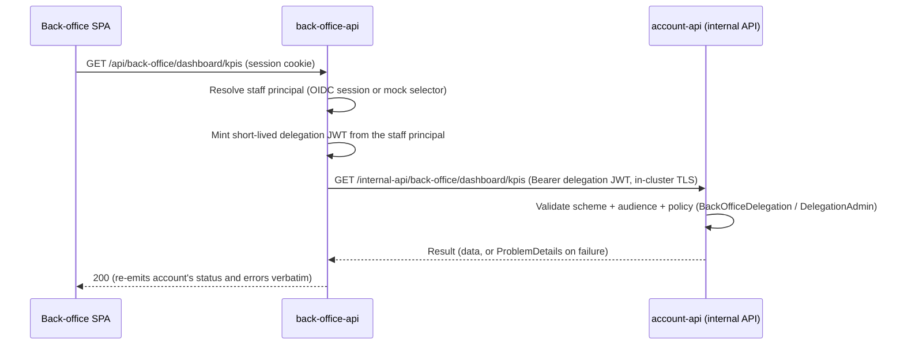

# Application code

The application code for EuropeanPlatform is divided into self-contained systems. Each self-contained system is a large microservice (or a small monolith) that contains a full vertical slice of the system, including a React frontend plus a .NET API and .NET Workers that share the same core. Each system can be developed and tested in isolation, and all parts of a self-contained system are deployed together. This makes self-contained systems a better option than having many small microservice APIs that share one big frontend.

These are the self-contained systems:
- `main` - the primary shell application where you build your product. It handles catch-all routing and hosts the account module via Module Federation, so navigation between product pages and account pages happens without full page reloads.
- `account` - a federated module for authentication, tenant signup, user management, and account settings. Loaded into the main system at runtime via Module Federation and shares the same navigation shell. It also exposes an internal API (`/internal-api/back-office/*`) that the back-office consumes (see [the back-office](#back-office)).
- `back-office` - the staff surface for operations and support, served on its own hostname. It owns the staff identity outright (a configured OIDC provider, with a mock identity selector as the development stand-in) and owns no database: it is a backend-for-frontend over the feature systems' internal APIs.

The point of EuropeanPlatform is not to create a distributed system. Since EuropeanPlatform has all the core functionalities of a SaaS solution, the idea is that you build your product in `main` and make only minimal changes to `account`. Ideally, you should not need additional self-contained systems unless you have a strong reason to create them. Remember, microservices are a solution to scale teams, not systems.

There are also some shared projects:
- `SharedKernel` - a foundation with generic functionalities and boilerplate code that are shared between self-contained systems. This ensures a secure and maintainable codebase. This not only guarantees a consistent architecture but also ensures that all self-contained systems are developed in a uniform manner, making it easy for developers to move between systems and focus on the business logic, rather than the infrastructure. In theory the shared kernel is maintained by the EuropeanPlatform team, and there should be no reason for you to make changes to this project.
- `AppGateway` - the single entry point for all self-contained systems, responsible for routing requests to the correct system using YARP reverse proxy as BFF (Backend for Frontend). It contains logic for refreshing access tokens, and it will eventually also handle tasks like rate limiting, caching, etc.
- `AppHost` - the Aspire App Host. In development it orchestrates starting all dependencies (PostgreSQL, Blob Storage, Mail Server) and then all self-contained systems in a single operation — a .NET alternative to Docker Compose. In publish mode it is also the deployment model: the Aspire publish/deploy pipeline generates and rolls out the Helm chart over the Terraform-provisioned cluster. If your self-contained system needs access to a different service, you can add it to the `AppHost` project.

## Account

Account handles multi-tenant SaaS essentials: tenant signup, user invitations, login (email OTP and Google OAuth), user profile and preferences, account settings, and a welcome onboarding flow. It is loaded into the main system as a federated module, meaning its React frontend is rendered inside the main shell without full page reloads.

The [Account.slnf](/application/account/Account.slnf) solution file contains the Account system, which can be built and tested in isolation.

Self-contained systems in EuropeanPlatform are divided into the following core projects following the design principles of Vertical Slice Architecture, Domain-Driven Design (DDD), and Command Query Responsibility Segregation (CQRS):

1. `WebApp`: The WebApp is built with React, ShadCN 2.0 with Base UI, Rsbuild, Turborepo, and more. It's completely separated from the Backend, ensuring that it can be developed in isolation using e.g. Visual Studio Code (or Rider or Visual Studio).

2. `Api`: Built with ASP.NET Minimal API, this project implements the REST API. The main system serves the `index.html` from the SPA as a fallback (if no server endpoint was matched). This eliminates the need for a separate web server to serve the static frontend. When the SPA `index.html` is served it injects environment configurations (app version, CDN URLs) and user info to avoid an extra API call.

    All API endpoints are extremely thin, with only one line of code in each endpoint, delegating the work to the Core layer:

    ```csharp
    group.MapPost("/invite", async Task<ApiResult> (InviteUserCommand command, IMediator mediator)
        => await mediator.Send(command)
    );
    ```

3. `Core`: The Core layer consists of the use cases of the system implemented as MediatR commands and queries. Each command and query is a vertical slice of the system, containing all the logic needed to complete a task. This layer is also responsible for validation using FluentValidation. Here's an example showing the CreateUser command, its handler, and its validator. Note that the command, handler, and validator are all in the same file. This aligns with the Single Responsibility Principle (SRP), making the code easy to understand and more maintainable.

   `/Core/Features/Users/Commands/CreateUser.cs`

    ```csharp
    internal sealed record CreateUserCommand(TenantId TenantId, string Email, UserRole UserRole, bool EmailConfirmed, string? PreferredLocale)
        : ICommand, IRequest<Result<UserId>>
    {
        public string Email { get; } = Email.Trim().ToLower();
    }

    internal sealed class CreateUserValidator : AbstractValidator<CreateUserCommand>
    {
        public CreateUserValidator()
        {
            RuleFor(x => x.Email).SetValidator(new SharedValidations.Email());
        }
    }

    internal sealed class CreateUserHandler(
        IUserRepository userRepository,
        AvatarUpdater avatarUpdater,
        GravatarClient gravatarClient,
        ITelemetryEventsCollector events,
        IExecutionContext executionContext
    ) : IRequestHandler<CreateUserCommand, Result<UserId>>
    {
        public async Task<Result<UserId>> Handle(CreateUserCommand command, CancellationToken cancellationToken)
        {
            if (!await userRepository.IsEmailFreeAsync(command.Email, cancellationToken))
            {
                return Result<UserId>.BadRequest($"The user with '{command.Email}' already exists.");
            }

            var user = User.Create(command.TenantId, command.Email, command.UserRole, command.EmailConfirmed, locale);
            await userRepository.AddAsync(user, cancellationToken);

            events.CollectEvent(new UserCreated(user.Id, user.Avatar.IsGravatar));

            return user.Id;
        }
    }
    ```

    `/Core/Features/Users/Domain/User.cs`

    ```csharp
    [PublicAPI]
    [IdPrefix("usr")]
    [JsonConverter(typeof(StronglyTypedIdJsonConverter<string, UserId>))]
    public sealed record UserId(string Value) : StronglyTypedUlid<UserId>(Value);

    public sealed class User : SoftDeletableAggregateRoot<UserId>, ITenantScopedEntity
    {
        private User(TenantId tenantId, string email, UserRole role, bool emailConfirmed, string? locale)
            : base(UserId.NewId())
        {
            Email = email;
            TenantId = tenantId;
            Role = role;
            EmailConfirmed = emailConfirmed;
            Locale = locale ?? string.Empty;
        }

        public string Email { get; private set; }

        public UserRole Role { get; private set; }

        public TenantId TenantId { get; }

        public static User Create(TenantId tenantId, string email, UserRole role, bool emailConfirmed, string? locale)
        {
            return new User(tenantId, email, role, emailConfirmed, locale);
        }
    }
    ```

    `/Core/Features/Users/Domain/UserRepository.cs`

    ```csharp
    public interface IUserRepository : ICrudRepository<User, UserId>, IBulkRemoveRepository<User>, ISoftDeletableRepository<User, UserId>
    {
        Task<bool> IsEmailFreeAsync(string email, CancellationToken cancellationToken);
    }

    internal sealed class UserRepository(AccountDbContext accountDbContext, IExecutionContext executionContext, TimeProvider timeProvider)
        : SoftDeletableRepositoryBase<User, UserId>(accountDbContext), IUserRepository
    {
        public async Task<bool> IsEmailFreeAsync(string email, CancellationToken cancellationToken)
        {
            return !await DbSet
                .IgnoreQueryFilters([QueryFilterNames.SoftDelete])
                .AnyAsync(u => u.Email == email.ToLowerInvariant(), cancellationToken);
        }
    }
    ```

Please note that all IDs are strongly typed (like `TenantId` and `UserId`), even at the API endpoints. This ensures a more expressive codebase.

The architecture is designed according to [screaming architecture](https://blog.cleancoder.com/uncle-bob/2011/09/30/Screaming-Architecture.html). This means that there is one namespace (folder) per feature, using business-related names like `Tenants` and `Users`, making the concepts easily visible and expressive, rather than organizing the code by types like `models`, `services`, `repositories`, etc.

Tests for the Account system are conducted using xUnit, with SQLite for in-memory database testing. The tests can be run directly in JetBrains Rider, Visual Studio, or with the `test` cli command. The tests focus on the behavior of the system, not the implementation details. This is done by focusing on testing the API instead of Application and Domain classes when possible.

## Back-office

The back-office is the staff surface for operations and support: the dashboard, billing, tenants, users, and feature-flag management. It runs on its own hostname (`back-office.<domain>`), is deployed as its own workload (`back-office-api`), and is developed as its own self-contained system — the [BackOffice.slnf](/application/back-office/BackOffice.slnf) solution file builds and tests it in isolation.

It owns two things outright:

1. **The staff identity.** A configured OpenID Connect provider (`BackOffice:Oidc`) takes precedence; the mock identity selector (a dev/staging stand-in that picks a fixed admin or regular staff identity) applies when no provider exists. The identity machinery — the identity handler, the OIDC login, the mock selector — lives in the back-office system (`BackOffice.Authentication`), not in the shared kernel.
2. **The staff-facing contract.** The SPA talks to `/api/back-office/*` on the back-office API only.

It deliberately owns no database: reads and writes are served over the feature systems' **internal APIs**. The back-office is a backend-for-frontend; account (and later other feature systems) own the data and expose an internal API the back-office calls with the signed-in staff member's authority.

### The delegation contract

The seam between the back-office and the feature systems is a short-lived, platform-signed delegation JWT, defined once in the shared kernel so every feature system can validate tokens without depending on the back-office system:

- `SharedKernel.Authentication.BackOfficeDelegationDefaults` — the scheme, audience, policies, and shared claim types (`groups`, `name`).
- `SharedKernel.Authentication.BackOfficeDelegationTokenGenerator` — mints the token (signed with the shared platform token-signing key).
- `SharedKernel.Authentication.BackOfficeAdminRequirement` — the admin gate: the delegation token must carry a `groups` claim matching `BackOffice:AdminsGroupId`.



The contract rules, all enforced by the system tests on both sides:

- **Bearer, not cookies**: internal API calls authenticate with the delegation token, so those routes disable antiforgery and are never reachable from a browser hostname.
- **Least privilege per route**: reads require the delegation policy; mutations additionally require the admin group. A rejected staff member never reaches the internal API — the back-office's own policies forbid it first.
- **Distinct token populations**: the delegation scheme is separate from the application's JWT scheme, and each rejects the other's tokens (audience mismatch) — a stolen app token cannot call internal APIs, and a delegation token cannot act as a user.
- **Verbatim error propagation**: the feature system's ProblemDetails (status, message, validation errors) are re-emitted as-is, so a domain 400 never masquerades as a 500.
- **In-cluster TLS**: the internal API is served over TLS trusted through the Terraform-managed internal CA.

Tests cover both sides of the seam: the internal API suite (on `account`) mints delegation tokens directly against `/internal-api/back-office/*`, and the back-office system tests run the full BFF pipeline — identity, policies, delegation minting, and error propagation — with only the internal API's transport stubbed.
